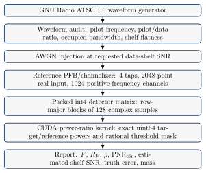

# Installation and standalone usage

The purpose of this page is to describe the standalone and CUDA workflows. A
complete CPU-only installation and paper check are given in [the first-run
walkthrough](FIRST_RUN.md). The environment and the clone below are created from
any chosen workspace, and the remaining commands are run from the repository
root. Archive runs follow the local or CANFAR runbook.

## Environment

We run the standalone workflows in one Python virtual environment, which can be
in any writable, persistent directory and need not be in the source checkout.
The selected Python must provide `venv` and `ensurepip`. On a minimal Debian or
Ubuntu installation, these come from `python3-venv`, or `PYTHON_BIN` can be set
to a Miniconda or session Python that already provides them.

```bash
export VENV_DIR="${VENV_DIR:-$HOME/.venvs/pilot-proxy-archive}"
export PYTHON_BIN="${PYTHON_BIN:-python3}"
mkdir -p "$(dirname "$VENV_DIR")"
"$PYTHON_BIN" -m venv "$VENV_DIR"
source "$VENV_DIR/bin/activate"
```

Shared and image-managed Python installations may be read-only or marked as
externally managed under PEP 668. In those environments, packages are installed
into the virtual environment and never with a bare `pip`. On a managed GPU
image, the option `--system-site-packages` at environment creation keeps the
CuPy and CUDA packages of the image visible. An isolated CPU installation is
made without it. The environment is activated in every new session, and it
persists only when `VENV_DIR` is on persistent storage, such as `/arc` on
CANFAR. The CANFAR runbook uses `setup_env.sh`, which creates and recreates its
own configured environment, so that environment is never created by hand.

---

## Fresh clone and minimal CPU-only smoke test

This smoke test checks the Python package, the CLI entry point, and the
reference detector metadata. It requires no GNU Radio, CADC credentials, CUDA,
or CHIME HDF5 data, and it is run in the [environment](#environment) above
before any standalone workflow.

```bash
export REPO_DIR="${REPO_DIR:-$PWD/pilotproxy}"
git clone https://github.com/WVURAIL/pilotproxy.git "$REPO_DIR"
cd "$REPO_DIR"
python -m pip install -U pip setuptools wheel
python -m pip install -e ".[test]"

pilot-proxy --help
python -m pytest tests/test_cli.py -q
pilot-proxy check-profile \
    --receiver-profile configs/receiver_profiles/reference_800mhz_pfb.json
pilot-proxy check-layout \
    --receiver-profile configs/receiver_profiles/reference_800mhz_pfb.json
```

### Repository test targets

The smoke test runs only `tests/test_cli.py`. The Python test target of the
repository needs the test extra and is run with:

```bash
python -m pip install -e ".[test]"
make test-python
```

The `test` extra installs `h5py`, Matplotlib, and PyYAML, because the checked-in
tests exercise the CHIME HDF5 adapters, the plotting paths, and the YAML
configuration loaders. These tests generate or mock their inputs and need no
CHIME data files. CADC-backed checks are skipped when archive credentials are
not available.

`make test` runs `test-kernel` before `test-python`, so it needs a CUDA build
host. The driver and the compiler are checked first with:

```bash
command -v nvidia-smi && nvidia-smi --query-gpu=name,compute_cap --format=csv
command -v nvcc && nvcc --version
```

`nvidia-smi` ships with the NVIDIA driver, and on WSL it comes through the WSL
CUDA support of the Windows driver. When it is unavailable, `make test-python`
is used in place of `make test` or `make test-kernel`. The `make release-check`
target adds the CPU C/C++ reference checks, the profile and layout checks, and
the runtime-bundle validation. It requires a C++ compiler but no GPU.

The required GPU gate is `make test-gpu DETECTOR_WINDOW_SAMPLES=128`, which
builds temporary K=64 and K=128 libraries and runs the archive interrupt and
resume tests. A missing GPU prerequisite fails this gate. The component map, the
GNU Radio checks, and the remaining validation limits are in [test
coverage](../docs/TEST_COVERAGE.md).

---

## Contents

The repository keeps the detector, the integration code, the configuration, and
the operating documentation in these paths:

- `cuda/` - CUDA kernel, public C header, CPU C++ reference, and C++ tests.
- `src/pilot_proxy/` - Python package for kernel loading, detector geometry,
  reference channelization, DTV unit conversion, CHIME adapters, and testbench
  workflows.
- `src/pilot_proxy/testbench/` - GNU Radio ATSC generation, waveform audit,
  AWGN generation, quantization, and SNR evaluation.
- `src/pilot_proxy/archive/` - bounded inventory, staging, streaming, CHIME
  sources and readers, the detector analyzer, scan, and combine support.
- `weights/` - prebuilt ATSC reference detector weights for
  `detector_window_samples=128`, `num_weight_terms=3`,
  `skipped_guard_bins=1`, `reference_offset_bins=2`, physical channels 14-36,
  and 4+4 bit samples.
- `configs/` - detector-core, receiver-profile, and stream-map JSON examples for
  standalone and integration workflows.
- `scripts/setup_env.sh` - one-shot CANFAR archive setup script for the
  integrated CHIME workflow.
- `scripts/launch_gpu_session.py` - launch, reuse, or tear down a CANFAR CUDA GPU
  notebook session (skaha / `canfar` client) for the detector path.
- `INTEGRATION.md` - detailed standalone archive integration notes.
- `docs/METHOD_SPEC.md` - equation-first method contract for CHIME products.
- `docs/PRODUCT_SCHEMA.md` - the only supported per-pilot product contract.
- `docs/PER_PILOT_PRODUCT_FIELDS.md` - detailed shared-field reference.
- `docs/FINE_REDUCTION_PRODUCTS.md` - fine-measurement and diagnostic fields.
- `docs/CHIME_RUN_WORKFLOW.md` - staged-data workflow (`chime-run`) for
  already-staged HDF5 directories. Archive-scale `chime-scan` runs follow the
  local or CANFAR guide below.
- `docs/DATA_PRODUCTS.md` - emitted file, array, and table definitions.
- `docs/LOCAL_PROCESSING.md` - authoritative local WSL archive procedure.
- `docs/CANFAR_RUNBOOK.md` - bounded CANFAR operating procedure.
- `docs/OPERATOR_HANDOFF.md` - runtime-bundle and Kotekan handoff notes.
- `docs/DESIGN_DECISIONS.md` - recorded detector and integration decisions.
- `docs/PilotProxy_DS001_Data_Sheet.tex` - formal data sheet (build to PDF).
- `docs/PilotProxy_UG001_User_Guide.tex` - formal user guide (build to PDF).
- `examples/quickstart.sh` - standalone release sanity-check workflow (CUDA and
  GNU Radio, with environment-specific defaults that are overridden with `SM`,
  `CUDA_PYTHON`, and `GNURADIO_PYTHON`).

We commit the documentation sources and the small, explicitly named artifacts
needed for reproducibility: the shipped weight banks and manifests, frozen test
fixtures, and dated scientific-provenance snapshots. Ordinary run products,
rebuilt plots, formal-document PDFs, generated TeX facts, and CUDA shared
libraries are ignored build artifacts. The shipped weight banks are described in
`weights/README.md`.

Built wheels contain the shipped receiver profiles, stream map, weight bank, and
weight manifest. The CUDA shared library is architecture-specific and is not
packaged. Before the GPU detector runs, the library is built from a source
checkout and staged under `~/.cache/pilot_proxy/libpilotproxy.so`.

---

## Setup for the CHIME / CANFAR workflow

The integrated workflow uses this repository and the pinned archive client in
`requirements/archive.txt`. The `scripts/setup_env.sh` script recreates a
virtual environment and installs `.[archive,test]`. It checks the bundled
source, reader, and analyzer classes directly. On a GPU node, it also requires
`nvcc`, builds the CUDA kernel, and checks that the kernel loads. The script
removes and recreates the target environment, so `VENV_DIR` must never point to
an environment that needs to be preserved. The script refuses the home
directory, the checkout, overlapping directories, and non-empty targets it does
not own. A genuine virtual environment created by an older checkout is adopted
on its first guarded rerun only with the explicit acknowledgement
`PILOT_PROXY_ADOPT_LEGACY_VENV=1`. Later rebuilds use the durable ownership
record beside the environment and can be retried after an interruption.

The full procedure is in
[docs/CANFAR_RUNBOOK.md](../docs/CANFAR_RUNBOOK.md#environment-setup).
It gives the exact `setup_env.sh` invocation, a manual setup that does not
recreate an environment, GPU-session launch, Harbor registry credentials,
required inputs, and bounded run sequences. Integration-specific details are in
[INTEGRATION.md](../INTEGRATION.md#setup).

A manual installation in an active virtual environment uses:

```bash
python -m pip install -r requirements/archive.txt
python -m pip install -e ".[archive,test]"
```

---

## Receiver integration contract

A receiver integration translates telescope data into the detector's fixed
input contract. It provides:

- `receiver_profile.json` describing RF band, channelizer geometry, Nyquist
  zone, frame size, input streams, quantization policy, bin ENBW, and pilot
  capture efficiency;
- optional `stream_map.json` describing the input-stream ordering;
- channelized complex input arrays or packed detector matrices;
- a generated weight bank built from the receiver profile.

After this translation, the CUDA kernel sees only:

- packed int4 detector rows;
- packed int4 weights;
- uint64 fine powers per term and fine bin, and the uint64 target/reference
  frame powers that are their all-bin sums.

CHIME run products record the detector contract in
`run_config.json` and `stats.json` with:

- `schema_version = pilotproxy_detector_contract_v2`;
- K, weight-term, skipped-guard, and reference-offset geometry;
- packed input and uint64 accumulator metadata;
- the all-row summation rule;
- the positive-excess mask policy;
- reference-placement summary metadata.

The integration metadata is validated with:

```bash
pilot-proxy check-profile   --receiver-profile configs/receiver_profiles/chime_dtv_fengine.json

pilot-proxy check-layout   --receiver-profile configs/receiver_profiles/chime_dtv_fengine.json   --stream-map configs/stream_maps/chime_feed_pol_example.json
```

Each shipped receiver profile has its own role and evidential status:

- `reference_800mhz_pfb.json` is the single-stream detector-coordinate reference
  profile used for shipped reference weights and tests.
- `chime_dtv_fengine.json` is the target CHIME DTV adapter profile used by the
  current integration: 2048 feed-polarization streams, Nyquist zone 2 (each
  channel's spectrum mirrored), a 4-tap sinc-Hamming PFB,
  descending RF channel order, and `frame_size_samples=16384`. The 16384-sample
  frame is the target of the CHIME F-engine upgrade, and the profile makes no
  claim about the frame deployed today. The profile is frame-verified (`profile_status` in the
  file), and these values must still be verified against the data product of an
  operational run.
- `chord_dtv_fengine.json` and `chord_pathfinder_dtv_fengine.json` are the CHORD
  and CHORD Pathfinder adapter profiles for the Kotekan integration. Both use the
  CHORD channelization, with a 3.2 GS/s ADC, the first Nyquist zone, a
  16384-point PFB, 8192 coarse channels of exactly 195312.5 Hz, an upright
  channel spectrum, ascending channel order, and a channel RF center of
  `coarse_channel_index * 195312.5 Hz` (the kotekan `freq_id` namespace). They
  differ only in stream count, with 1024 dish-polarization streams (512 dishes)
  for full CHORD and 128 (64 dishes) for the Pathfinder. The 8192-sample detector
  frame is exactly one kotekan GPU frame (41.94304 ms), and at K=64 it gives the
  frozen fine-reduction geometry of 128 windows per stream. The pilots of ATSC
  channels 14 through 36 land in CHORD channels 2408 through 3084. Channels 14
  and 21 are the adaptive reference cases. The upper reference of channel 14
  wraps the frame edge, and the lower reference of channel 21 shifts off the
  forbidden DC bin and wraps the frame edge. These profiles declare
  `metadata.channel_id_map`, so exported runtime bundles carry a populated
  `chord_channel_id` for kotekan first-frame profile selection. Both are marked
  `example_requires_data_product_verification`. The grid matches the kotekan
  chord-branch source, and the frame convention must still be verified against
  CRS F-engine data before an operational run (`docs/OPERATOR_HANDOFF.md`).

---

## Weight bank

We generate the default CHIME DTV weight bank from the receiver and detector
profiles:

```bash
pilot-proxy make-weights   --receiver-profile configs/receiver_profiles/chime_dtv_fengine.json   --detector-core-profile configs/detector_core/pilotproxy_cuda_local_reference_power_ratio.json   --physical-channel-range 14:36   --weight-coordinate-system post_nyquist_zone_normalization   --output weights/chime_dtv_weights_k128.bin
```

By default, the detector looks for:

```text
weights/chime_dtv_weights_k128.bin
```

The weights file stays at the default path, or its path is passed explicitly to
each command that consumes it:

```bash
pilot-proxy list-channels --weights-path weights/chime_dtv_weights_k128.bin
pilot-proxy chime-run --weights-path weights/chime_dtv_weights_k128.bin --help
```

`list-channels` reports the reference placement for each physical channel.
Adaptive cases also print an explanatory `NOTE`, and the CSV output is
unchanged. The shipped banks use `reference_offset_bins=2` and
`skipped_guard_bins=1`, so one detector bin is skipped on each side of the
target, and the next detector bin is used as the lower or upper reference.
Placement works in the periodic normalized-frequency coordinate of the
coarse-channel FFT. A reference requested past the baseband-frame origin
(nu = 0) therefore wraps modulo 1, and the wrapped weights are bit-identical to the
unwrapped ones. The manifest records this case as `edge_wrapped`, although under
the center-at-DC CHIME profile nu = 0 is the coarse-channel center (the
forbidden DC tone). The manifest's `frame_origin_description` states which point
the origin is. A reference that collides with the forbidden coarse-channel DC
tone moves one bin farther from the target, and the manifest records a placement
warning. A collision of the target with DC stops weight generation, because the
target cannot be moved. The manifest's `*_crosses_channel_edge` fields (and a
`list-channels` `NOTE`) also report a reference requested more than fs/2 from the
channel center. Such a reference aliases to the opposite channel edge and
samples the channelizer roll-off. The note changes neither the placement nor the
detection arithmetic.

In the shipped CHIME bank for ATSC channels 14 through 36, physical channel 14
is the only adaptive case. Its pilot is one detector bin above the
coarse-channel center (DC), so its lower reference lands one bin below DC, with
the forbidden DC tone in the skipped guard between them
(`forbidden_tone_in_skipped_guard`), and `list-channels` prints the
corresponding placement `NOTE`. No shipped channel collides with the forbidden
DC tone or requires a DC shift, and the remaining channels use the nominal
reference placement. The upper reference of channel 21 crosses the physical
coarse-channel half-width (+196.7 kHz against 195.3 kHz), and `list-channels`
prints a `NOTE` for it.

For deployment, the profiles and weights are exported as a compact runtime
bundle, and the bundle is then validated:

```bash
pilot-proxy export-runtime-weight-bundle   --receiver-profile configs/receiver_profiles/chime_dtv_fengine.json   --detector-core-profile configs/detector_core/pilotproxy_cuda_local_reference_power_ratio.json   --weight-coordinate-system post_nyquist_zone_normalization   --physical-channel-range 14:36   --output-dir generated/deploy/chime_dtv_k128

pilot-proxy validate-runtime-weight-bundle   --bundle-dir generated/deploy/chime_dtv_k128
```

---

## CUDA kernel

On a GPU host:

```bash
nvidia-smi --query-gpu=name,compute_cap --format=csv
```

The build uses the integer `SM` form of the compute capability, which is the
capability with the decimal point removed:

| Compute capability | `SM` |
|---:|---:|
| 8.0 | 80 |
| 8.6 | 86 |
| 8.9 | 89 |
| 9.0 | 90 |

The Python GPU path uses CuPy. In the integrated CHIME/CANFAR workflow,
`setup_env.sh` resolves CuPy through the bundled archive accelerator API. A
standalone CUDA 12.x workflow installs it with
`python -m pip install -e ".[cuda]"`. The `cuda` extra installs `cupy-cuda12x`, and a runtime other than
CUDA 12.x needs the corresponding `cupy-cudaXXx` package.

Both `setup_env.sh` and the `make` targets detect `SM` from the first GPU
visible to `nvidia-smi`. `SM=<arch>` is passed only when detection fails or when
cross-compiling for another architecture. The build records the architecture and
kernel configuration in its build stamp. If either value changes, the next build
recompiles the kernel.

### CUDA toolchain (`nvcc`)

The kernel build requires the CUDA compiler, `nvcc`, on `PATH`:

```bash
command -v nvcc && nvcc --version
```

On some CANFAR CUDA images, `nvcc` is installed under `/usr/local/cuda/bin` but
that directory is not on `PATH`. If `command -v nvcc` returns a path such as
`/usr/bin/nvcc`, `make build-kernel` is used without setting `NVCC`. Otherwise,
the compiler is located with:

```bash
find /usr/local -maxdepth 4 -path '*/bin/nvcc' -type f 2>/dev/null
```

Its directory is then added to `PATH`:

```bash
export PATH=/path/to/cuda/bin:$PATH
```

The compiler path can also be passed directly, since `cuda/Makefile` honors
`NVCC=`:

```bash
make build-kernel NVCC=/path/to/cuda/bin/nvcc
```

If `nvcc` is absent, the build needs a CANFAR image that ships the CUDA toolkit,
such as `skaha/astroml-cuda`, or an installed toolkit that matches the runtime.
A runtime-only image may run CuPy while it still lacks the compiler needed for
this kernel, and in that case `make test` and `make test-kernel` stop at the
`nvcc` step. On a CPU-only host, `make test-python` and `make release-check` are
used, since neither target requires a GPU.

The kernel is built and staged with:

```bash
make build-kernel
```

This builds `cuda/libpilotproxy.so` and stages a copy to:

```text
~/.cache/pilot_proxy/libpilotproxy.so
```

After the build, the library is loaded through Python, and its compile-time
contract is printed with:

```bash
PYTHONPATH=src python - <<'PY'
from pilot_proxy.kernel import PilotProxyKernel
kernel = PilotProxyKernel()
print(kernel.specs.as_descriptive_dict())
print(kernel.features.as_dict())
print(kernel.version.as_string())
PY
```

This output describes the CUDA kernel only. `detector_window_samples=128` is
`K`, which is both the detector-row length and the number of coefficients in
each of the three packed weight vectors (target, lower reference, and upper
reference). `K` is not the receiver frame length.

The receiver profile supplies `frame_size_samples`. The reference and CHIME
profiles set `frame_size_samples=16384`, so the tested configuration gives:

```text
windows_per_stream = frame_size_samples / detector_window_samples
                   = 16384 / 128
                   = 128

detector_rows_per_frame = num_input_streams * num_selected_channels * windows_per_stream
```

For the target CHIME profile and one selected coarse channel, the row count is:

```text
2048 feed-pol streams * 1 selected channel * 128 windows_per_stream = 262144 rows
```

Thus, one frame in this profile is packed as `(262144, 128)`, and a batch is
packed as `(frames_in_chunk, 262144, 128)`. The fine power spectrum of each term
is formed over every stream and window, and the frame powers are its all-bin
sums. One local-reference power ratio is formed from those sums for the frame or
block. This geometry holds for the 16384-sample frame of the profile.
`check-layout` prints and validates the geometry derived from the profile:

```bash
pilot-proxy check-layout \
    --receiver-profile configs/receiver_profiles/chime_dtv_fengine.json \
    --stream-map configs/stream_maps/chime_feed_pol_example.json
```

This command checks the configuration and reads no CHIME file. The CHIME profile
records the baseband-frame verification performed in 2026-07, but its planned
F-engine frame size, stream count, and ordering must still be compared with the
operational data product of each run.

The shared library is loaded by PilotProxy and is not executed directly.

The compiled CUDA/C++ regression tests are run with:

```bash
make test-kernel
```

---

## CHIME archive workflow

To keep a fixed staging bound during an archive-scale run, we use
`pilot-proxy chime-scan`. It runs the PilotProxy analyzer through the bundled
archive engine, writes one product for each selected pilot with usable input,
and attempts to combine those products into the canonical CHIME outputs. If no
`(event, frame-in-file)` identity is common to every completed pilot, the
per-pilot products are preserved, and stacking waits until a compatible channel
subset is chosen with `pilot-proxy chime-combine`.

The archive command sequence is:

```bash
pilot-proxy chime-survey --name chime-pilots --freq-ids <freq_ids>
pilot-proxy chime-inventory --inventory-name chime-pilots
pilot-proxy chime-scan --inventory-name chime-pilots --output-dir <detector_run>
```

Two constraints set how we run it. First, selection uses the CHIME `freq_id`
coarse-channel namespace in place of ATSC physical-channel numbers. For
`--source cadc-datatrail`, a scan without `--select` covers each `freq_id`
present in the inventory, and the command prints that set before staging
begins. `--select` restricts the set. The `--inventory` and `--inventory-name`
flags also let `chime-scan` infer the archive source. The 23 `freq_id` values
for the default pilot range of ATSC channels 14 through 36 are listed in
[docs/CANFAR_RUNBOOK.md](../docs/CANFAR_RUNBOOK.md#selection-convention), and
`844` is the single-channel smoke-test value for the pilot of ATSC channel 14.

Second, `chime-scan` is the supported path. Downloads may run concurrently,
while the analyzer still receives files in inventory order. The defaults are one
worker and one staged file, and `--download-workers` and `--max-staged-files`
raise the bounded prefetch depth.

The following documents give the complete selection rules, local and
CADC/CANFAR sequences, order constraint, and post-processing commands:

- [docs/RERUN_PARAMETER_REGISTER.md](../docs/RERUN_PARAMETER_REGISTER.md) for the frozen scientific and product settings;
- [docs/VALIDATION_GATES.md](../docs/VALIDATION_GATES.md) for the mandatory local launch gates;
- [docs/LOCAL_PROCESSING.md](../docs/LOCAL_PROCESSING.md) for the measured local workstation profile and the sole production command;
- [INTEGRATION.md](../INTEGRATION.md) for the standalone archive integration contract; and
- [docs/CANFAR_RUNBOOK.md](../docs/CANFAR_RUNBOOK.md) for the alternate bounded remote workflow.

---

## Standalone synthetic/testbench workflow

`tools/current_geometry_sensitivity.py` runs the staged, paired measurement of
fixed-point against floating-point sensitivity at the 2048-stream geometry, and
its module docstring describes the method. The compact commands below are smoke
tests of the waveform and detector, and their reduced examples give no
publication sensitivity estimate.

<p align="center">
  
</p>

The Data Sheet and the User Guide carry the same diagram, and all three are
rendered from the single source `docs/figures/validation_flow.tikz` (the header
of that file gives the one-command SVG re-render).

When GNU Radio is installed only in the system Python, the standalone workflow
uses two interpreters:

- GNU Radio Python for ATSC generation and GNU Radio AWGN;
- CUDA Python for CuPy and the CUDA local-reference power ratio library.

An ATSC waveform without injected noise is generated with:

```bash
PYTHONNOUSERSITE=1 PYTHONPATH=src /usr/bin/python3   -m pilot_proxy.testbench.generate_atsc_signal   --output-iq generated/atsc/atsc_8vsb_complex64.cfile   --num-iq-samples 600000
```

The generated waveform is audited with:

```bash
PYTHONPATH=src python   -m pilot_proxy.testbench.audit_atsc_signal   --input-iq generated/atsc/atsc_8vsb_complex64.cfile   --fail-on-quality
```

The audit writes `generated/atsc/atsc_waveform_audit.json` and reports five
measured properties: pilot frequency error, pilot level relative to the data
shelf, occupied bandwidth, shelf flatness, and channel-edge rolloff. A waveform
that meets all configured bounds prints `quality_passed=True (5/5)` and the
margin for each check. With `--fail-on-quality`, the command exits nonzero when
any bound is not met. This result validates the generated waveform against those
five checks only, and no receiver implementation is validated by it.

The detector input is packed with:

```bash
PYTHONPATH=src python   -m pilot_proxy.testbench.quantize   --input-iq generated/atsc/atsc_8vsb_complex64.cfile   --physical-channel 14   --frame-size-samples 16384   --num-input-streams 1
```

A small SNR evaluation is run with:

```bash
PYTHONPATH=src python   -m pilot_proxy.testbench.evaluate_snr   --input-iq generated/atsc/atsc_8vsb_complex64.cfile   --physical-channel 14   --frame-size-samples 16384   --num-input-streams 1   --requested-data-shelf-snr-db -26   --noise-trials 10
```

This command writes `generated/dtv_snr_eval/dtv_snr_summary.csv`. The
`snr_error_db_mean` and `snr_error_db_std` columns summarize estimated shelf SNR
minus the injected or measured reference. For the packed fixed-point path,
`cpu_gpu_abs_diff_max` measures agreement between the CUDA detector and the CPU
reference and is expected to be zero. Ten noise trials make a smoke test and are
too few for a final uncertainty estimate. A larger `--noise-trials` is needed
when the uncertainty of the reported mean and standard deviation is part of the
result.

---

## Figures

We use LaTeX-style fonts for figures. By default, Matplotlib renders Computer
Modern with mathtext, which requires no TeX installation. With
`PILOT_PROXY_USE_TEX=1`, external TeX is used when `latex`, `dvipng`, and the
`cm-super` fonts are installed, and CI leaves this option disabled. Figure
writers emit 300 dpi PNG files by default, and
`PILOT_PROXY_FIGURE_FORMATS=png,pdf` also writes a vector PDF with the same
stem.

## Build documentation

Generated PDFs are ignored by git and are built locally with:

```bash
make docs        # latexmk; scratch in docs/auxil/, PDFs in docs/out/
make docs-specs-check  # validate canonical documentation facts without writing
```

The package set tested on Debian/Ubuntu is:

```bash
sudo apt-get install --no-install-recommends \
    texlive-latex-base texlive-latex-recommended texlive-latex-extra \
    texlive-fonts-recommended texlive-pictures lmodern latexmk
```

Figures rendered with `PILOT_PROXY_USE_TEX=1` also require
`dvipng cm-super ghostscript`. The tested CANFAR session images provide neither TeX nor root
access, so the documentation is built on another host.

---
